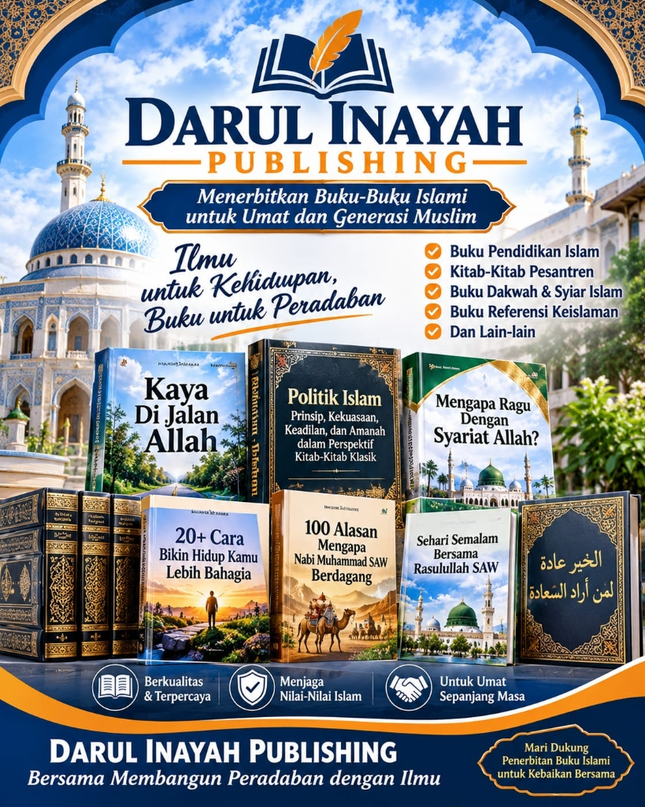

# Darul Inayah Publishing

Portal Penerbitan Buku Akademik, Monograf Ilmiah, dan Khazanah Keislaman dengan standar telaah mutu (*peer-review*), registrasi ISBN resmi, dan pengindeksan terintegrasi (Crossref DOI, Google Scholar, Moraref).



## 📖 Slogan & Nilai Fondasi
- **Tagline:** *"Ilmu untuk Kehidupan, Buku untuk Peradaban"*
- **Visi:** *"Menerbitkan Buku-Buku Islami untuk Umat dan Generasi Muslim"*
- **Motto:** *"Bersama Membangun Peradaban dengan Ilmu"*
- **3 Pilar Nilai:**
  1. **Berkualitas & Terpercaya**
  2. **Menjaga Nilai-Nilai Islam**
  3. **Untuk Umat Sepanjang Masa**

## 🌟 Fitur Utama Website
1. **Beranda Akademik (Home):**
   - Hero Section dengan integrasi poster resmi dan pencarian instan publikasi (judul, penulis, ISBN, topik).
   - Sorotan khusus (*Flagship Showcase*) karya **Al Ustadz Hidayat Taufiq**: *"Mengapa Ragu Dengan Syariat Allah ?"*.
   - Rilis katalog terbaru, statistik penerbitan, dan infografis 4 tahap alur penerbitan (*submission to print*).
2. **Katalog Publikasi (Publications):**
   - Filter bidang keilmuan (*Pendidikan Islam, Kitab Pesantren, Dakwah & Syiar, Referensi Keislaman, Monograf Ilmiah*).
   - Mode tampilan ganda: *Grid Card View* & *Academic Table View* (gaya portal jurnal internasional).
3. **Detail Buku Komprehensif (Book Detail):**
   - Cover 3D realistis, metadata bibliografi (ISBN, e-ISBN, DOI, Halaman, Tahun, Kota Terbit).
   - Tab berkas: Abstrak & Keywords, Daftar Isi lengkap, Profil Penulis & Sambutan Ulama, KDT/Hak Cipta, dan Daftar Pustaka (19 rujukan kitab).
   - Generator kutipan sitasi ilmiah otomatis (**APA 7th, MLA 9th, Chicago 17th, BibTeX, RIS Mendeley/Zotero**).
4. **Pembaca Digital Interaktif (Digital Book Reader):**
   - Akses membaca langsung isi bab naskah asli buku lengkap dengan teks Arab kaligrafi (*Amiri*), terjemahan berbingkai, dan catatan kaki.
   - Personalisasi ukuran font (A- / A+), pilihan font (*Merriweather, Playfair Display, Plus Jakarta Sans*), tema pembaca (*Light, Sepia Paper, Dark Mode*), dan *fullscreen*.
5. **Direktori Penulis & Panduan (Authors):**
   - Profil para ulama dan penulis, afiliasi, publikasi, dan ID ORCID.
   - Panduan penyerahan naskah (*Author Guidelines*) dan transliterasi Arab-Latin SKB 2 Menteri.
6. **Layanan Redaksi & Kontak (Contact):**
   - Formulir pengajuan proposal buku baru, konversi tesis/disertasi, pesanan cetak, dan kemitraan kampus.

## 🛠️ Teknologi yang Digunakan
- **React 18** (Vite 5)
- **Tailwind CSS 3**
- **Lucide React** (Modern Academic Icons)
- **Google Fonts** (*Amiri*, *Playfair Display*, *Merriweather*, *Plus Jakarta Sans*)

## 🚀 Cara Menjalankan Secara Lokal
```bash
# 1. Masuk ke direktori proyek
cd "c:\Users\ahmad\Documents\Web Mas Panca"

# 2. Instalasi dependensi (jika belum)
npm install

# 3. Jalankan server lokal
npm run dev
```
Buka browser pada: `http://localhost:3000`

---
© Darul Inayah Publishing. Hak Cipta Dilindungi Undang-Undang.
